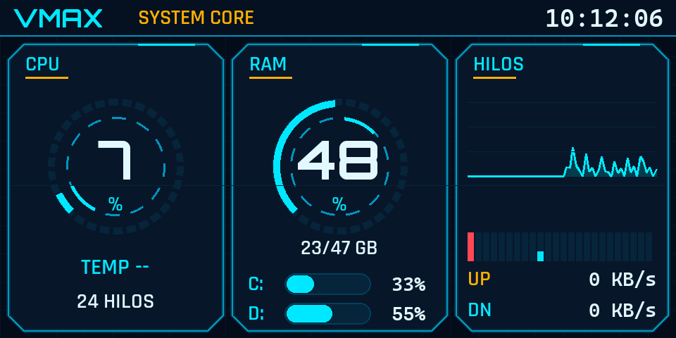

# Display VMAX para el gabinete Aurora XYZ



*Vista previa del tema vmax renderizada desde el código. Los datos son reales de la PC en ese momento.*

Un panel de telemetría tipo HUD para el mini display USB del gabinete. Muestra la carga de CPU y RAM, los 24 hilos, el uso de los discos y la red, con temas inspirados en los HUD de videojuegos y de autos.

**Por qué existe:** la app del fabricante consumía unos 300 MB de RAM para mostrar datos que no necesitaba. Este proyecto hace lo mismo con Python, en unos 50 MB y con un solo proceso.

## Qué trae

- Varios temas en `themes/`, incluido **vmax** (medidores de anillo, gráfico de historial y barras por hilo).
- Cambio de tema en caliente con `tema.bat`, sin reiniciar el motor.
- Icono en la bandeja del sistema para cambiar de tema o salir (`display_todo.pyw`).
- Arranque silencioso al iniciar sesión (`iniciar_silencio.vbs`).

## Requisitos

- Windows 10 u 11 (las versiones Linux de los scripts `tema.sh`, `waybar-display.sh` y `systemd/` siguen incluidas).
- Python 3.13.
- Un driver **WinUSB** en el dispositivo del display (se configura con [Zadig](https://zadig.akeo.ie/)).
  Ojo: esto quita el puerto serie COM que expone el display, así que la app del fabricante deja de funcionar mientras tanto.

## Uso rápido

```bat
tema.bat              :: menú de temas
tema.bat vmax         :: cambia de tema (en caliente)
tema.bat stop         :: detiene el display
iniciar_silencio.vbs vmax   :: lanza sin ventana (lo que usa el inicio de sesión)
```

## Aviso

Es un proyecto independiente y no tiene relación con el fabricante del gabinete. Usalo bajo tu propio riesgo: cambiar el driver del dispositivo afecta cómo lo usa el software del fabricante.

Las imágenes de marcas y los fondos de `assets/` no se incluyen en este repositorio. Los temas que los usan siguen funcionando con un fondo neutro.
